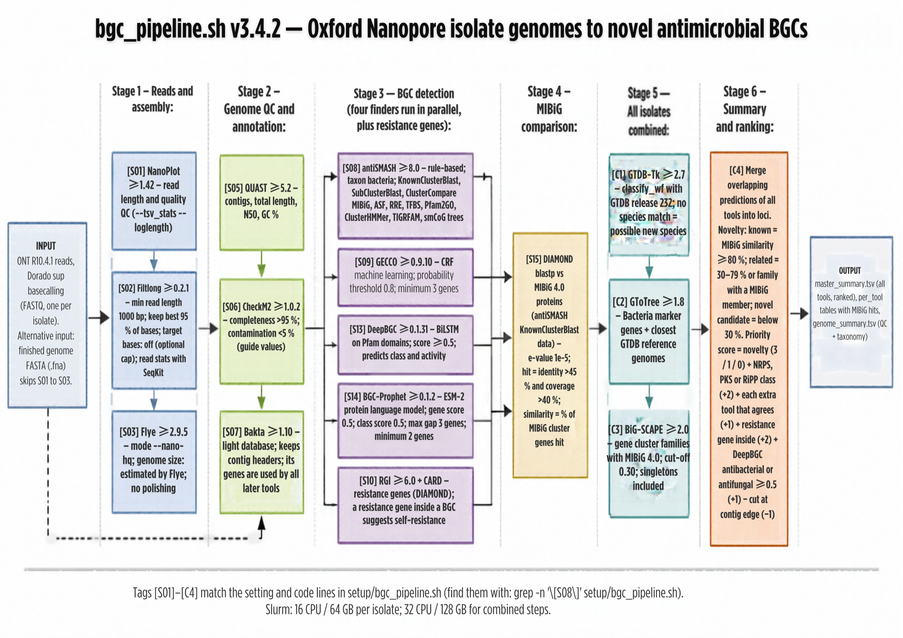

# Fantastic drugs and where to find them 

**From Oxford Nanopore reads of soil isolates to a ranked list of novel antimicrobial gene clusters.**

`bgc_pipeline.sh` is a single bash script. It takes every isolate in `raw_data/` and does the following for each one:

1. Checks and filters the reads.
2. Assembles the genome (no polishing: R10.4.1 reads basecalled with Dorado *sup* are accurate enough).
3. Annotates all genes.
4. Finds the biosynthetic gene clusters (BGCs) that make specialised metabolites such as antibiotics, with four independent tools: antiSMASH, GECCO, DeepBGC and BGC-Prophet.

It then compares all isolates and all BGCs with databases of *known* clusters. The result is one master table that merges the four tools, adds QC and taxonomy, and ranks which BGCs are most likely to be **new**.

The pipeline was built for the Tiny Earth soil isolates in our 7th-semester project (AAU, 2026). It should work for any bacterial isolate sequenced with ONT.

---

## Pipeline overview
The overalle work flow of the pipeline is portrayed below


---

## What each step does

The **Tag** matches the box in the flowchart and the `[tag]` at the end of every setting and code line for that program in `setup/bgc_pipeline.sh`. To find everything for one program, for example antiSMASH: `grep -n '\[S08\]' setup/bgc_pipeline.sh`.

| Tag | Program | What it does | Why it matters | Output folder |
|---|---|---|---|---|
| S01 | **NanoPlot** | Read length and quality plots | Catches a bad sequencing run before hours of assembly | `01_nanoplot/` |
| S02 | **Filtlong** | Removes short and low-quality reads | Cleaner input gives a better assembly | `02_filtlong/` |
| S03 | **Flye** | De novo genome assembly (no polishing) | Long reads span the repeated modules inside NRPS/PKS genes, so BGCs come out complete | `03_flye/` (or `03_genome/` when a finished genome was given) |
| S05 | **QUAST** | Number of contigs, genome length, N50, GC% | Shows how complete the assembly is in one piece | `05_quast/` |
| S06 | **CheckM2** | Completeness and contamination | Confirms the genome is complete (> 95 %) and the culture is pure (< 5 %) | `06_checkm2/` |
| S07 | **Bakta** | Finds and names all genes | Every later tool uses the same gene calls (Bakta replaces Prokka, which is no longer maintained) | `07_bakta/` |
| S08 | **antiSMASH** | Rule-based BGC detection, compared with MIBiG | Finds NRPS, PKS, RiPP, terpene and other clusters, and reports the % similarity to known BGCs | `08_antismash/` |
| S09 | **GECCO** | Machine-learning BGC detection | Independent second opinion; can find clusters that antiSMASH's rules miss | `09_gecco/` |
| S10 | **RGI + CARD** | Antibiotic resistance genes | A resistance gene *inside* a BGC suggests self-resistance, so the product is likely an antibiotic | `10_rgi_card/` |
| S13 | **DeepBGC** | Deep-learning BGC detection + product class and **activity** (antibacterial, antifungal, cytotoxic, inhibitor) | A third opinion, and the only tool here that predicts activity. It calls more, smaller BGCs than antiSMASH | `13_deepbgc/` |
| S14 | **BGC-Prophet** | Protein-language-model (ESM-2) BGC detection + product class | Fourth opinion that does not depend on Pfam domains, so it can catch unusual clusters | `14_bgc_prophet/` |
| S15 | **DIAMOND vs MIBiG** | Compares every tool's BGCs with MIBiG, the way antiSMASH's KnownClusterBlast does | Gives GECCO, DeepBGC and BGC-Prophet BGCs a closest known cluster too | `15_mibig/` |
| C1 | **GTDB-Tk** | Species identification from the genome | Much finer than 16S. "No species match" means a possible new species | `_combined/gtdbtk/` |
| C2 | **GToTree** | Phylogenetic tree | Places the isolates next to their closest reference genomes | `_combined/gtotree/` |
| C3 | **BiG-SCAPE** | Groups BGCs into families together with MIBiG | A family *without* any known (MIBiG) member means no characterised relative | `_combined/bigscape/` |
| C4 | **Summary** | One table per tool, plus a master table that merges all tools and ranks every BGC | Tells you which clusters to look at first | `_combined/summary/` |

---

## Quick start

```bash
# 1. Get the pipeline (the folders raw_data/, setup/ and results/ are already in the repository)
git clone https://github.com/Mikkelbenn2/Fantastic-drugs-and-where-to-find-them.git
cd Fantastic-drugs-and-where-to-find-them

# 2. Install all programs and databases (once per server, Note this takes hours, due to the GTDB-tK database being large; run inside tmux)
tmux new -s setup
bash setup/bgc_pipeline.sh setup

# 3. Put the reads in raw_data/ and check that they are found
cp -r /path/to/reads/* raw_data/
bash setup/bgc_pipeline.sh list

# 4. Check the commands without running anything
bash setup/bgc_pipeline.sh run --dry-run

# 5. Run
bash setup/bgc_pipeline.sh submit     # on a Slurm cluster: one job per isolate
bash setup/bgc_pipeline.sh run        # or: everything here, one isolate after another
```

You need `conda`, `mamba` or `micromamba` on your PATH (on many servers: `module load miniforge`). The setup step creates one conda environment per program, so the tools never conflict with each other.

---

## Folder layout

```
Fantastic-drugs-and-where-to-find-them/
├── README.md
├── raw_data/                  ← your reads
│   ├── isolate1.fastq.gz         one file per isolate, or
│   └── barcode02/                one folder per isolate (many FASTQ files are joined)
│   └── strainX.fna               or a finished genome (.fasta/.fna/.fa): no read QC or assembly
├── setup/
│   ├── bgc_pipeline.sh        ← the pipeline
│   ├── envs/                     one conda environment per program (created by setup)
│   ├── databases/                antiSMASH, Bakta, CheckM2, CARD, GTDB-Tk, DeepBGC, BGC-Prophet (created by setup)
│   └── tests/test_summary.sh     self-check of the summary code (needs only python3)
└── results/
    ├── <isolate>/                one folder per isolate, one subfolder per program
    │   ├── 01_nanoplot/ … 10_rgi_card/
    │   ├── 11_gtdbtk/            this isolate's taxonomy
    │   ├── 12_novelty/           this isolate's antiSMASH BGCs, ranked
    │   ├── 13_deepbgc/  14_bgc_prophet/  15_mibig/
    │   └── logs/                 exact command + full output of every program
    ├── _combined/                analyses across all isolates
    │   ├── gtdbtk/  gtotree/  bigscape/
    │   └── summary/              master_summary.tsv   ← start here
    │                             per_tool/{antismash,gecco,deepbgc,bgc_prophet}_bgcs.tsv
    │                             genome_summary.tsv, bgc_summary.tsv (antiSMASH-only ranking, as before)
    ├── slurm_logs/
    └── software_versions.tsv     exact version of every program (for your Methods)
```

Isolate names come from the file or folder names in `raw_data/`. For example, `SRR24673188/` becomes the isolate `SRR24673188`.

---

## Reading the results

### `genome_summary.tsv`: one row per isolate

| Column | Meaning |
|---|---|
| `raw_reads`, `raw_bases`, `raw_read_N50`, `raw_meanQ` | Read data before filtering (also given after filtering, as `filtered_*`) |
| `genome_length`, `contigs`, `N50`, `GC_percent` | Assembly statistics (QUAST) |
| `circular_contigs`, `mean_depth` | From Flye. Note that *Streptomyces* chromosomes are linear, which is normal |
| `completeness`, `contamination` | CheckM2 (%) |
| `gtdb_classification`, `closest_ANI`, `possible_new_species` | GTDB-Tk |
| `BGCs_antismash`, `BGCs_gecco`, `BGCs_deepbgc`, `BGCs_bgc_prophet`, `BGC_loci_all_tools`, `resistance_genes` | Counts per isolate |

### `master_summary.tsv`: all tools merged, one row per BGC locus, best candidates first

Predictions from the four tools that overlap on the same contig are merged into one **locus**.

| Column | Meaning |
|---|---|
| `rank`, `priority_score`, `novelty` | Order in which to inspect the loci (see the score below) |
| `isolate`, `locus_id`, `contig`, `start`, `end`, `length_kb` | Where the locus is (start/end span all tools' predictions) |
| `tools`, `n_tools` | Which tools found it. Found by several tools = well supported |
| `antismash_regions`, `antismash_type`, `antismash_class`, `gecco_type`, `deepbgc_class`, `bgc_prophet_class` | Each tool's prediction of the product type |
| `deepbgc_activity`, `deepbgc_max_antibacterial_or_antifungal` | DeepBGC's activity prediction and its highest antibacterial/antifungal score |
| `closest_MIBiG`, `closest_MIBiG_compound`, `MIBiG_similarity_pct`, `MIBiG_from` | Best MIBiG match over all tools' predictions, and which tool/method gave it |
| `resistance_gene_in_locus` | Possible self-resistance gene (RGI/CARD) |
| `bigscape_family`, `family_MIBiG_members` | BiG-SCAPE family of the antiSMASH region(s) |
| `contig_edge` | `yes` means the antiSMASH region touches a contig end and may be incomplete |
| `genome_length` … `contamination`, `gtdb_classification` … `possible_new_species` | QC and taxonomy of the isolate, copied onto every row |

### `per_tool/<tool>_bgcs.tsv`: one table per BGC finder

One row per BGC as that tool predicted it, with the tool's own scores and the same MIBiG columns for every tool (`MIBiG_accession`, `MIBiG_compound`, `MIBiG_similarity_pct`, `MIBiG_method`). antiSMASH BGCs use antiSMASH's own KnownClusterBlast result. The other tools' BGCs are scored the same way from `15_mibig/`: the percentage of a MIBiG cluster's genes hit by the BGC's genes at > 45 % identity and > 40 % coverage, against the same MIBiG data antiSMASH uses. `locus_id` links each row to `master_summary.tsv`.

### `bgc_summary.tsv`: one row per antiSMASH BGC (unchanged from earlier versions)

| Column | Meaning |
|---|---|
| `rank`, `priority_score` | Order in which to inspect the BGCs |
| `novelty` | `novel_candidate`, `related`, `known`, or `gecco_only_check_manually` |
| `bgc_type`, `bgc_class` | e.g. `NRPS`, `T1PKS`, `lanthipeptide` / class NRPS, PKS, RiPP… |
| `closest_MIBiG`, `closest_MIBiG_compound`, `MIBiG_similarity_pct` | Closest known cluster and how similar it is |
| `gecco_agrees` | Whether GECCO found the same region |
| `resistance_gene_in_BGC` | Possible self-resistance gene |
| `bigscape_family`, `family_MIBiG_members`, `family_in_n_isolates` | Gene-cluster family, any known members, and how many of your isolates share it |
| `contig_edge` | `yes` means the cluster may be incomplete |

### How novelty is decided

| `MIBiG_similarity_pct` (antiSMASH KnownClusterBlast) | Label |
|---|---|
| ≥ 80 % | `known`: probably a known compound |
| 30–79 %, or in a BiG-SCAPE family with a MIBiG BGC | `related`: possibly an analogue |
| < 30 % or no hit | `novel_candidate` |

**Priority score** in `master_summary.tsv`:

| Evidence | Points |
|---|---|
| `novel_candidate` / `related` | +3 / +1 |
| NRPS, PKS or RiPP (by any tool) | +2 |
| Each extra tool that found the locus | +1 (max +3) |
| Resistance gene inside the locus | +2 |
| DeepBGC antibacterial or antifungal score ≥ 0.5 | +1 |
| On a contig edge | −1 |

(`bgc_summary.tsv` keeps the old score, where "GECCO agrees" gives +1 instead of the tool and activity points.)

The score is a triage aid. It tells you which clusters to open first in `results/<isolate>/08_antismash/index.html`. It does **not** prove that a compound is new or active.

---

## Settings

All settings are in the block at the top of `bgc_pipeline.sh`. These are the most important ones:

| Setting | Default | Change it when… |
|---|---|---|
| `THREADS` | 16 | You want more or fewer CPUs (inside Slurm it is taken from the job) |
| `FLYE_READ_MODE` | `nano-hq` | Your reads are old R9.4.1 or fast-basecalled data: use `nano-raw` |
| `GENOME_SIZE` | empty | You know it, e.g. `8m` for *Streptomyces* |
| `FILTLONG_TARGET_BASES` | empty | Coverage is very deep (> 150x): cap it at about 100 × genome size |
| `SHARED_GTDBTK_DB`, `SHARED_BAKTA_DB`, `SHARED_CHECKM2_DB`, `SHARED_ANTISMASH_DB` | AAU server: `/databases/...` | You are on another server: point them at its shared databases, or set `""` to let `setup` download them |
| `RUN_GTDBTK`, `RUN_GTOTREE`, `RUN_GECCO`, `RUN_DEEPBGC`, `RUN_BGCPROPHET`, `RUN_RGI`, `RUN_BIGSCAPE` | 1 | You want to skip a program |
| `DEEPBGC_SCORE`, `BGCPROPHET_THRESHOLD`, `BGCPROPHET_CLASSIFY_T` | 0.5 | You want the ML tools stricter (higher) or looser (lower) |
| `GECCO_THRESHOLD`, `GECCO_MIN_CDS` | 0.8, 3 | GECCO stricter/looser (its defaults) |
| `BGCPROPHET_MAX_GAP`, `BGCPROPHET_MIN_COUNT` | 3, 2 | BGC-Prophet cluster joining (README values) |
| `MIBIG_EVALUE` | 1e-05 | DIAMOND e-value for the MIBiG comparison of all tools |
| `BGCPROPHET_DEVICE` | `cpu` | Your Slurm job has a GPU: use `cuda` |
| `GTOTREE_HMM` | `Bacteria` | All isolates are actinomycetes: use `Actinobacteria` |
| `KNOWN_SIMILARITY`, `RELATED_SIMILARITY` | 80, 30 | You want stricter or looser novelty labels |
| `SLURM_PARTITION`, `SLURM_*_MEM`, `SLURM_*_TIME` | cluster default | Your cluster needs a partition name or other resources |

---

## Useful commands

| You want to… | Command |
|---|---|
| See which isolates were found | `bash setup/bgc_pipeline.sh list` |
| Run only one isolate | `bash setup/bgc_pipeline.sh run --sample SRR24673188` |
| Continue after a crash or timeout | Run the same command again. Finished steps are skipped |
| Redo one step | `bash setup/bgc_pipeline.sh run --force 08_antismash` |
| Redo only the comparison steps | `bash setup/bgc_pipeline.sh combined` |
| Follow Slurm jobs | `squeue --me` and `tail -f results/slurm_logs/*.out` |
| Find out why a step failed | `tail -n 30 results/<isolate>/logs/<step>.log` |
| Check the summary code after editing it | `bash setup/tests/test_summary.sh` |
| Validate the pipeline on known genomes | `bash setup/bgc_pipeline.sh controls`, then `bash setup/bgc_pipeline.sh check-controls` (see `controls/README.md`) |

---

## Resources

| | Approximate need |
|---|---|
| Disk: programs | ~25 GB |
| Disk: databases | ~130 GB (GTDB-Tk alone is ~110 GB) |
| Disk: results | 2–5 GB per isolate |
| Time per isolate | ~2–4 hours with 16 CPUs (Flye and antiSMASH take the longest) |
| Memory | 32–64 GB per isolate; GTDB-Tk needs ~64–100 GB |

On the AAU BioCloud server, `setup` links every folder in `/databases` into `setup/databases/biocloud/` and uses a shared database whenever it fits the installed program version: GTDB-Tk (release 232) and CheckM2 come from `/databases`. The shared Bakta (2022) and antiSMASH (5.1.0) databases are too old, and CARD is not there, so `setup` downloads those three. At the end, `setup` prints which database each program uses. Elsewhere, run `setup` on a login node with internet access, because compute nodes often have none.

---

## Limitations

- **Silent clusters.** A BGC in the genome is not necessarily expressed, and the compound behind the inhibition zone on the plate may come from a cluster the tools did not detect.
- **Reference bias.** MIBiG contains only a few thousand characterised BGCs. "No similarity" can mean new, or simply that the cluster was never deposited.
- **Similarity is not chemistry.** Confirm promising candidates with chemical analysis (e.g. LC-MS/MS) and activity assays.

---

## Citing the tools

Cite each program by its paper:

- **NanoPlot:** De Coster & Rademakers (2023), *Bioinformatics* 39:btad311.
- **Filtlong:** github.com/rrwick/Filtlong.
- **Flye:** Kolmogorov et al. (2019), *Nat Biotechnol* 37:540–546.
- **QUAST:** Gurevich et al. (2013), *Bioinformatics* 29:1072–1075.
- **CheckM2:** Chklovski et al. (2023), *Nat Methods* 20:1203–1212.
- **Bakta:** Schwengers et al. (2021), *Microb Genom* 7:000685.
- **antiSMASH 8:** Blin et al. (2025), *Nucleic Acids Res* 53:W32–W38.
- **MIBiG 4.0:** Zdouc et al. (2025), *Nucleic Acids Res*.
- **GECCO:** Carroll et al. (2021), *bioRxiv* 10.1101/2021.05.03.442509.
- **DeepBGC:** Hannigan et al. (2019), *Nucleic Acids Res* 47:e110.
- **BGC-Prophet:** Lai et al. (2025), *Nucleic Acids Res*, 10.1093/nar/gkaf305.
- **DIAMOND:** Buchfink et al. (2021), *Nat Methods* 18:366–368.
- **RGI/CARD:** Alcock et al. (2023), *Nucleic Acids Res* 51:D690–D699.
- **GTDB-Tk:** Chaumeil et al. (2022), *Bioinformatics* 38:5315–5316.
- **GToTree:** Lee (2019), *Bioinformatics* 35:4162–4164.
- **BiG-SCAPE 2:** *bioRxiv* (2025) 10.1101/2025.08.20.671210.

Check page numbers and DOIs against the original papers before they go into a report. The exact program versions used in each run are in `results/software_versions.tsv`.

---

## Author and acknowledgements

| | |
|---|---|
| **Author** | Mikkel Bennetsen ([@Mikkelbenn2](https://github.com/Mikkelbenn2)), Aalborg University |
| **Project** | P7 — AI-assisted genome mining for antimicrobial discovery in Tiny Earth soil isolates (2026) |
| **Version** | 3.4.2 (last updated 2026-11-09) |
| **License** | MIT (see `LICENSE`) |

**AI assistance.** This pipeline was developed with help from Claude (Anthropic). It was used to draft and test the code, helped select and compare tools, and helped write the documentation. The author decided the design, reviewed the code, and tweaked the parameters.

**How to cite this pipeline**

> Bennetsen M. (2026). *bgc_pipeline.sh v3.4.2: a Nanopore pipeline for screening soil isolates for novel biosynthetic gene clusters.* https://github.com/Mikkelbenn2/Fantastic-drugs-and-where-to-find-them

Please also cite the individual programs it runs (listed above).
