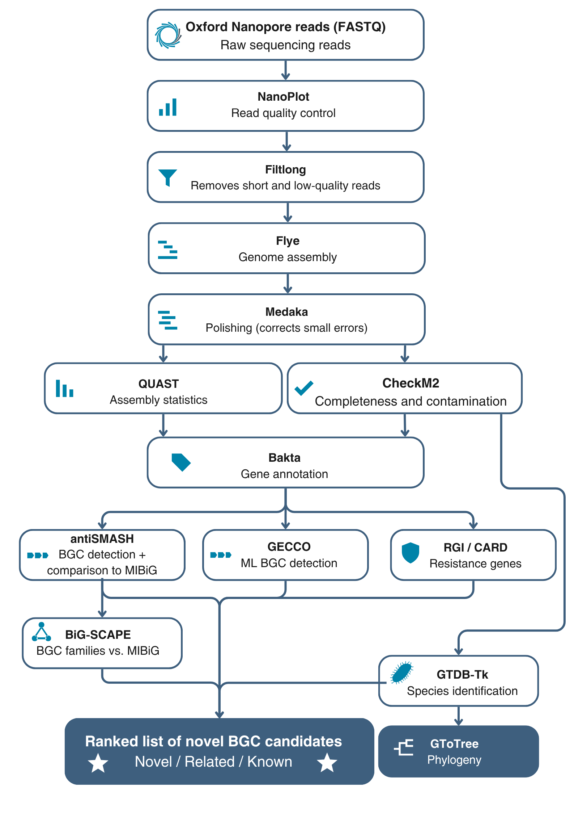

# Fantastic drugs and where to find them 

**From Oxford Nanopore reads of soil isolates to a ranked list of novel antimicrobial gene clusters.**

`bgc_pipeline.sh` is a single bash script. It takes every isolate in `raw_data/` and does the following for each one:

1. Checks and filters the reads.
2. Assembles and polishes the genome.
3. Annotates all genes.
4. Finds the biosynthetic gene clusters (BGCs) that make specialised metabolites such as antibiotics.

It then compares all isolates and all BGCs with databases of *known* clusters. The result is a ranked table showing which BGCs are most likely to be **new**.

The pipeline was built for the Tiny Earth soil isolates in our 7th-semester project (AAU, 2026). It should work for any bacterial isolate sequenced with ONT.

---

## Pipeline overview
The overalle work flow of the pipeline is portrayed below


---

## What each step does

| # | Program | What it does | Why it matters | Output folder |
|---|---|---|---|---|
| 1 | **NanoPlot** | Read length and quality plots | Catches a bad sequencing run before hours of assembly | `01_nanoplot/` |
| 2 | **Filtlong** | Removes short and low-quality reads | Cleaner input gives a better assembly | `02_filtlong/` |
| 3 | **Flye** | De novo genome assembly | Long reads span the repeated modules inside NRPS/PKS genes, so BGCs come out complete | `03_flye/` |
| 4 | **Medaka** | Polishing with the bacterial model | Fixes small errors. A single indel in a gene splits it in two and breaks BGC prediction | `04_medaka/` |
| 5 | **QUAST** | Number of contigs, genome length, N50, GC% | Shows how complete the assembly is in one piece | `05_quast/` |
| 6 | **CheckM2** | Completeness and contamination | Confirms the genome is complete (> 95 %) and the culture is pure (< 5 %) | `06_checkm2/` |
| 7 | **Bakta** | Finds and names all genes | Every later tool uses the same gene calls (Bakta replaces Prokka, which is no longer maintained) | `07_bakta/` |
| 8 | **antiSMASH** | Rule-based BGC detection, compared with MIBiG | Finds NRPS, PKS, RiPP, terpene and other clusters, and reports the % similarity to known BGCs | `08_antismash/` |
| 9 | **GECCO** | Machine-learning BGC detection | Independent second opinion; can find clusters that antiSMASH's rules miss | `09_gecco/` |
| 10 | **RGI + CARD** | Antibiotic resistance genes | A resistance gene *inside* a BGC suggests self-resistance, so the product is likely an antibiotic | `10_rgi_card/` |
| 11 | **GTDB-Tk** | Species identification from the genome | Much finer than 16S. "No species match" means a possible new species | `_combined/gtdbtk/` |
| 12 | **GToTree** | Phylogenetic tree | Places the isolates next to their closest reference genomes | `_combined/gtotree/` |
| 13 | **BiG-SCAPE** | Groups BGCs into families together with MIBiG | A family *without* any known (MIBiG) member means no characterised relative | `_combined/bigscape/` |
| 14 | **Summary** | Ranks every BGC | Tells you which clusters to look at first | `_combined/summary/` |

---

## Quick start

```bash
# 1. Get the pipeline (the folders raw_data/, setup/ and results/ are already in the repository)
git clone https://github.com/Mikkelbenn2/Fantastic-drugs-and-where-to-find-them.git
cd Fantastic-drugs-and-where-to-find-them

# 2. Install all programs and databases (once per server, Note this takes hours, due to the GTDB-tK database being large; run inside tmux)
tmux new -s setup
bash setup/bgc_pipeline.sh setup

# 3. Put the reads in raw_data/ and check that they are found
cp -r /path/to/reads/* raw_data/
bash setup/bgc_pipeline.sh list

# 4. Check the commands without running anything
bash setup/bgc_pipeline.sh run --dry-run

# 5. Run
bash setup/bgc_pipeline.sh submit     # on a Slurm cluster: one job per isolate
bash setup/bgc_pipeline.sh run        # or: everything here, one isolate after another
```

You need `conda`, `mamba` or `micromamba` on your PATH (on many servers: `module load miniforge`). The setup step creates one conda environment per program, so the tools never conflict with each other.

---

## Folder layout

```
Fantastic-drugs-and-where-to-find-them/
├── README.md
├── raw_data/                  ← your reads
│   ├── isolate1.fastq.gz         one file per isolate, or
│   └── barcode02/                one folder per isolate (many FASTQ files are joined)
├── setup/
│   ├── bgc_pipeline.sh        ← the pipeline
│   ├── envs/                     one conda environment per program (created by setup)
│   └── databases/                antiSMASH, Bakta, CheckM2, CARD, GTDB-Tk (created by setup)
└── results/
    ├── <isolate>/                one folder per isolate, one subfolder per program
    │   ├── 01_nanoplot/ … 10_rgi_card/
    │   ├── 11_gtdbtk/            this isolate's taxonomy
    │   ├── 12_novelty/           this isolate's BGCs, ranked
    │   └── logs/                 exact command + full output of every program
    ├── _combined/                analyses across all isolates
    │   ├── gtdbtk/  gtotree/  bigscape/
    │   └── summary/              genome_summary.tsv, bgc_summary.tsv   ← start here
    ├── slurm_logs/
    └── software_versions.tsv     exact version of every program (for your Methods)
```

Isolate names come from the file or folder names in `raw_data/`. For example, `SRR24673188/` becomes the isolate `SRR24673188`.

---

## Reading the results

### `genome_summary.tsv`: one row per isolate

| Column | Meaning |
|---|---|
| `raw_reads`, `raw_bases`, `raw_read_N50`, `raw_meanQ` | Read data before filtering (also given after filtering, as `filtered_*`) |
| `genome_length`, `contigs`, `N50`, `GC_percent` | Assembly statistics (QUAST) |
| `circular_contigs`, `mean_depth` | From Flye. Note that *Streptomyces* chromosomes are linear, which is normal |
| `completeness`, `contamination` | CheckM2 (%) |
| `gtdb_classification`, `closest_ANI`, `possible_new_species` | GTDB-Tk |
| `BGCs_antismash`, `BGCs_gecco`, `resistance_genes` | Counts per isolate |

### `bgc_summary.tsv`: one row per BGC, best candidates first

| Column | Meaning |
|---|---|
| `rank`, `priority_score` | Order in which to inspect the BGCs |
| `novelty` | `novel_candidate`, `related`, `known`, or `gecco_only_check_manually` |
| `bgc_type`, `bgc_class` | e.g. `NRPS`, `T1PKS`, `lanthipeptide` / class NRPS, PKS, RiPP… |
| `closest_MIBiG`, `closest_MIBiG_compound`, `MIBiG_similarity_pct` | Closest known cluster and how similar it is |
| `gecco_agrees` | Whether GECCO found the same region |
| `resistance_gene_in_BGC` | Possible self-resistance gene |
| `bigscape_family`, `family_MIBiG_members`, `family_in_n_isolates` | Gene-cluster family, any known members, and how many of your isolates share it |
| `contig_edge` | `yes` means the cluster may be incomplete |

### How novelty is decided

| `MIBiG_similarity_pct` (antiSMASH KnownClusterBlast) | Label |
|---|---|
| ≥ 80 % | `known`: probably a known compound |
| 30–79 %, or in a BiG-SCAPE family with a MIBiG BGC | `related`: possibly an analogue |
| < 30 % or no hit | `novel_candidate` |

**Priority score**:

| Evidence | Points |
|---|---|
| `novel_candidate` / `related` | +3 / +1 |
| NRPS, PKS or RiPP | +2 |
| GECCO agrees | +1 |
| Resistance gene inside the BGC | +2 |
| On a contig edge | −1 |

The score is a triage aid. It tells you which clusters to open first in `results/<isolate>/08_antismash/index.html`. It does **not** prove that a compound is new or active.

---

## Settings

All settings are in the block at the top of `bgc_pipeline.sh`. These are the most important ones:

| Setting | Default | Change it when… |
|---|---|---|
| `THREADS` | 16 | You want more or fewer CPUs (inside Slurm it is taken from the job) |
| `FLYE_READ_MODE` | `nano-hq` | Your reads are old R9.4.1 or fast-basecalled data: use `nano-raw` |
| `GENOME_SIZE` | empty | You know it, e.g. `8m` for *Streptomyces* |
| `FILTLONG_TARGET_BASES` | empty | Coverage is very deep (> 150x): cap it at about 100 × genome size |
| `SHARED_GTDBTK_DB`, `SHARED_BAKTA_DB`, `SHARED_CHECKM2_DB` | AAU server: `/databases/...` | You are on another server: point them at its shared databases, or set `""` to let `setup` download them |
| `POLISH` | 1 | Set to 0 to skip Medaka |
| `RUN_GTDBTK`, `RUN_GTOTREE`, `RUN_GECCO`, `RUN_RGI`, `RUN_BIGSCAPE` | 1 | You want to skip a program |
| `GTOTREE_HMM` | `Bacteria` | All isolates are actinomycetes: use `Actinobacteria` |
| `KNOWN_SIMILARITY`, `RELATED_SIMILARITY` | 80, 30 | You want stricter or looser novelty labels |
| `SLURM_PARTITION`, `SLURM_*_MEM`, `SLURM_*_TIME` | cluster default | Your cluster needs a partition name or other resources |

---

## Useful commands

| You want to… | Command |
|---|---|
| See which isolates were found | `bash setup/bgc_pipeline.sh list` |
| Run only one isolate | `bash setup/bgc_pipeline.sh run --sample SRR24673188` |
| Continue after a crash or timeout | Run the same command again. Finished steps are skipped |
| Redo one step | `bash setup/bgc_pipeline.sh run --force 08_antismash` |
| Redo only the comparison steps | `bash setup/bgc_pipeline.sh combined` |
| Follow Slurm jobs | `squeue --me` and `tail -f results/slurm_logs/*.out` |
| Find out why a step failed | `tail -n 30 results/<isolate>/logs/<step>.log` |

---

## Resources

| | Approximate need |
|---|---|
| Disk: programs | ~25 GB |
| Disk: databases | ~130 GB (GTDB-Tk alone is ~110 GB) |
| Disk: results | 2–5 GB per isolate |
| Time per isolate | ~2–4 hours with 16 CPUs (Flye and antiSMASH take the longest) |
| Memory | 32–64 GB per isolate; GTDB-Tk needs ~64–100 GB |

On the AAU bio-server, GTDB-Tk, Bakta and CheckM2 are already in `/databases` and are used automatically, so `setup` only downloads antiSMASH and CARD. Elsewhere, run `setup` on a login node with internet access, because compute nodes often have none.

---

## Limitations

- **Silent clusters.** A BGC in the genome is not necessarily expressed, and the compound behind the inhibition zone on the plate may come from a cluster the tools did not detect.
- **Reference bias.** MIBiG contains only a few thousand characterised BGCs. "No similarity" can mean new, or simply that the cluster was never deposited.
- **Similarity is not chemistry.** Confirm promising candidates with chemical analysis (e.g. LC-MS/MS) and activity assays.

---

## Citing the tools

Cite each program by its paper:

- **NanoPlot:** De Coster & Rademakers (2023), *Bioinformatics* 39:btad311.
- **Filtlong:** github.com/rrwick/Filtlong.
- **Flye:** Kolmogorov et al. (2019), *Nat Biotechnol* 37:540–546.
- **Medaka:** github.com/nanoporetech/medaka.
- **QUAST:** Gurevich et al. (2013), *Bioinformatics* 29:1072–1075.
- **CheckM2:** Chklovski et al. (2023), *Nat Methods* 20:1203–1212.
- **Bakta:** Schwengers et al. (2021), *Microb Genom* 7:000685.
- **antiSMASH 8:** Blin et al. (2025), *Nucleic Acids Res* 53:W32–W38.
- **MIBiG 4.0:** Zdouc et al. (2025), *Nucleic Acids Res*.
- **GECCO:** Carroll et al. (2021), *bioRxiv* 10.1101/2021.05.03.442509.
- **RGI/CARD:** Alcock et al. (2023), *Nucleic Acids Res* 51:D690–D699.
- **GTDB-Tk:** Chaumeil et al. (2022), *Bioinformatics* 38:5315–5316.
- **GToTree:** Lee (2019), *Bioinformatics* 35:4162–4164.
- **BiG-SCAPE 2:** *bioRxiv* (2025) 10.1101/2025.08.20.671210.

Check page numbers and DOIs against the original papers before they go into a report. The exact program versions used in each run are in `results/software_versions.tsv`.

---

## Author and acknowledgements

| | |
|---|---|
| **Author** | Mikkel Bennetsen ([@Mikkelbenn2](https://github.com/Mikkelbenn2)), Aalborg University |
| **Project** | P7 — AI-assisted genome mining for antimicrobial discovery in Tiny Earth soil isolates (2026) |
| **Version** | 3.0.0 (last updated 2026-10-12) |
| **License** | MIT (see `LICENSE`) |

**AI assistance.** This pipeline was developed with help from Claude (Anthropic). It was used to draft and test the code, helped select and compare tools, and helped write the documentation. The author decided the design, reviewed the code, and tweaked the parameters.

**How to cite this pipeline**

> Bennetsen M. (2026). *bgc_pipeline.sh v3.0.0: a Nanopore pipeline for screening soil isolates for novel biosynthetic gene clusters.* https://github.com/Mikkelbenn2/Fantastic-drugs-and-where-to-find-them

Please also cite the individual programs it runs (listed above).
